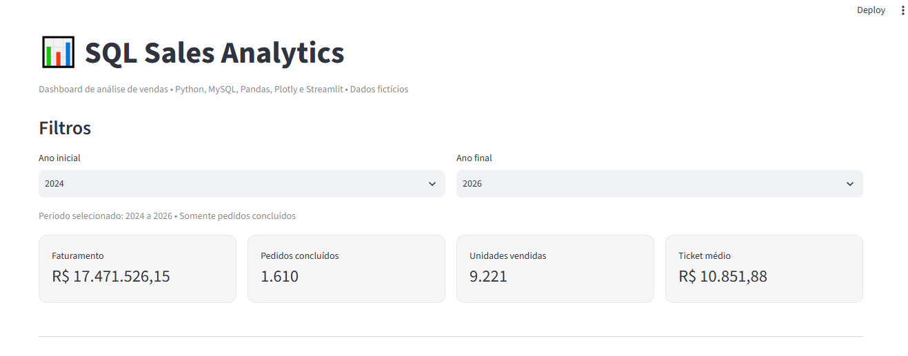
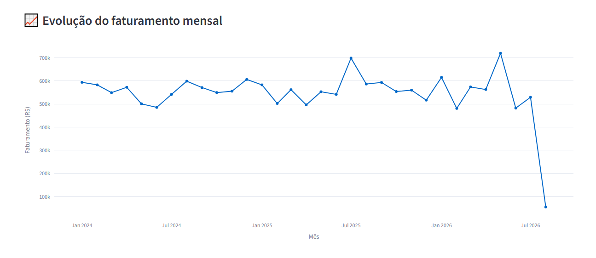
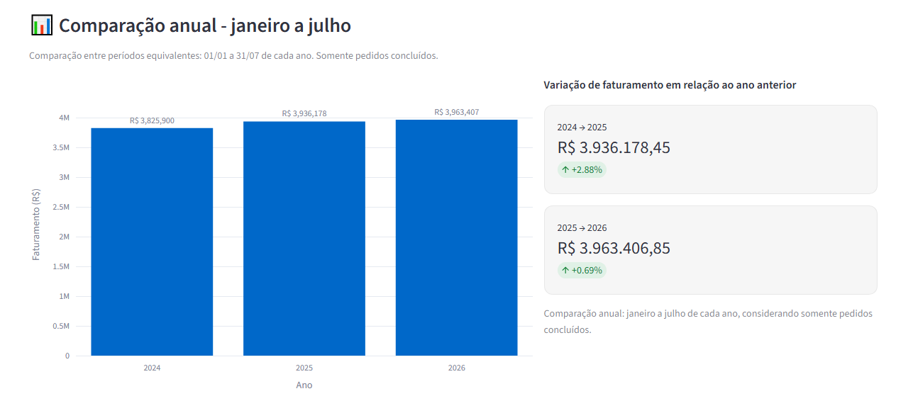
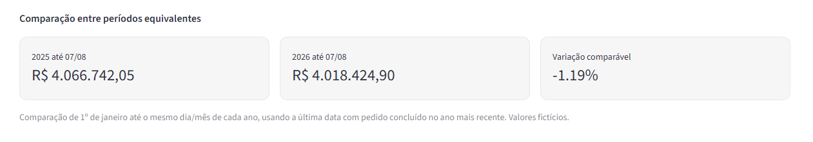
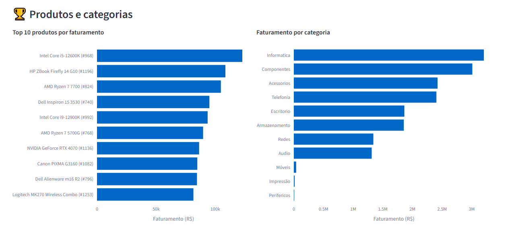
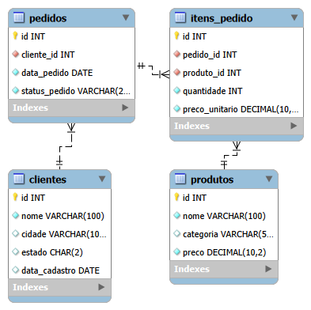

SQL Sales Analytics

Projeto de Portfólio | SQL • MySQL • Python • Pandas • Plotly • Streamlit

Projeto de análise de vendas desenvolvido para demonstrar competências em consultas SQL, modelagem relacional, tratamento e análise de dados, integração com Python e visualização de indicadores de negócio.

O projeto utiliza dados fictícios armazenados em um banco MySQL e apresenta os resultados em um dashboard interativo desenvolvido com Streamlit.

Objetivo do projeto

Transformar dados de vendas em informações úteis para apoiar a análise de desempenho comercial, permitindo:

* Acompanhar faturamento e volume de vendas.
* Identificar tendências mensais e anuais.
* Comparar o desempenho entre períodos.
* Avaliar produtos e categorias.
* Explorar indicadores de negócio com filtros interativos.

Tecnologias utilizadas

Tecnologia	Aplicação
MySQL 8	Banco de dados relacional
SQL	Consultas, relacionamentos e agregações
Python	Integração e processamento
Pandas	Manipulação de dados
Plotly	Gráficos interativos
Streamlit	Interface do dashboard
Git e GitHub	Versionamento e documentação

Estrutura do banco de dados

O projeto utiliza quatro tabelas principais:

Tabela	Finalidade
clientes	Cadastro de clientes
produtos	Catálogo de produtos
pedidos	Informações e status dos pedidos
itens_pedido	Produtos, quantidades e preços registrados em cada pedido

Relacionamentos principais:

* Um cliente pode realizar vários pedidos.
* Um pedido pode conter vários itens.
* Um produto pode aparecer em diferentes pedidos.

Essa estrutura permite analisar vendas por cliente, produto, categoria e período.

Indicadores do dashboard

O dashboard apresenta:

* Faturamento total: valor vendido nos pedidos concluídos.
* Pedidos concluídos: quantidade de pedidos válidos para a análise.
* Unidades vendidas: soma das quantidades dos itens vendidos.
* Ticket médio: faturamento dividido pelo número de pedidos concluídos.
* Evolução mensal: acompanhamento do faturamento ao longo do tempo.
* Comparação anual: análise de resultados e variação percentual.
* Períodos equivalentes: comparação entre intervalos de datas comparáveis.
* Top 10 produtos: produtos com maior faturamento.
* Faturamento por categoria: participação das categorias nas vendas.

Resultados de referência

Em uma análise realizada com a base fictícia, foram obtidos os seguintes indicadores para pedidos concluídos:

Indicador	Resultado
Faturamento	R$ 17.471.526,15
Pedidos concluídos	1.610
Unidades vendidas	9.221
Ticket médio	R$ 10.851,88

Os resultados representam uma referência da base analisada e podem mudar conforme os dados e os filtros selecionados.

Regras de negócio

1. Pedidos concluídos

Apenas pedidos com status_pedido = 'Concluido' entram nos indicadores de vendas.

2. Faturamento

O faturamento é calculado utilizando a quantidade vendida multiplicada pelo preço unitário registrado no momento da venda:

itens_pedido.quantidade * itens_pedido.preco_unitario

Dessa forma, alterações futuras no preço do catálogo não modificam o histórico financeiro das vendas.

3. Ticket médio

O ticket médio corresponde ao faturamento dividido pela quantidade de pedidos concluídos.

4. Comparação entre períodos

Comparar um ano completo com um ano ainda parcial pode produzir conclusões incorretas. Por isso, o dashboard inclui uma análise de períodos equivalentes, baseada na última data disponível nos pedidos concluídos.

5. Qualidade do catálogo

Parte do catálogo utiliza identificações genéricas Produto Portfolio. Existe uma revisão de nomes comerciais em andamento, mas os modelos sugeridos ainda dependem de validação individual e não devem ser considerados automaticamente verificados.

Estrutura do projeto

SQL-Sales-Analytics/
├── dashboard/
│   ├── app.py
│   └── conexao.py
├── database/
├── data/
├── docs/
│   └── imagens/
├── queries/
├── .env.example
├── .gitignore
├── README.md
└── requirements.txt

Como executar localmente

1. Pré-requisitos

* Python instalado.
* MySQL 8 instalado e em execução.
* Banco de dados do projeto configurado.
* Git, opcionalmente, para clonar o repositório.

2. Clonar o repositório

git clone https://github.com/carlosbuenodev-coder/SQL-Sales-Analytics.git
cd SQL-Sales-Analytics

3. Criar e ativar o ambiente virtual

python -m venv .venv
.\.venv\Scripts\Activate.ps1

4. Instalar as dependências

python -m pip install -r requirements.txt

5. Configurar a conexão com o MySQL

Crie um arquivo .env na pasta principal do projeto, no mesmo nível do arquivo README.md, utilizando o .env.example como referência.

Configure as seguintes variáveis:

MYSQL_HOST=localhost
MYSQL_PORT=3306
MYSQL_USER=seu_usuario
MYSQL_PASSWORD=sua_senha_local
MYSQL_DATABASE=sql_sales_analytics

O arquivo dashboard/conexao.py utiliza python-dotenv para carregar automaticamente essas configurações.

Segurança: o arquivo .env contém credenciais locais e não deve ser enviado ao GitHub. Verifique se ele está incluído no .gitignore.

6. Executar o dashboard

No terminal, na pasta principal do projeto:

python -m streamlit run dashboard/app.py

Acesse:

http://localhost:8501

Observação: o dashboard depende de uma instância MySQL configurada com o banco e os dados necessários. Não há uma base pública hospedada automaticamente pelo repositório.

## Evidências visuais

### Visão geral do dashboard

## Evolução do faturamento mensal

o gráfico apresenta a evolução mensal do faturamento dos pedidos concluídos. O último mês pode representar um período parcial, dependendo da disponibilidade de dados.

### Comparação anual

Análise do faturamento por ano, permitindo identificar tendências e diferenças entre os períodos.

### Comparação entre períodos equivalentes

Comparação de intervalos equivalentes para evitar distorções entre anos completos e parciais.

### Produtos e categorias

Análise dos produtos com maior faturamento e da participação das categorias nas vendas.

### Modelo relacional do banco de dados

Diagrama que apresenta as tabelas e os relacionamentos utilizados no projeto.

As imagens apresentadas nesta seção documentam o funcionamento do dashboard SQL Sales Analytics, os principais indicadores de negócio, as análises de faturamento e a estrutura relacional do banco de dados.

Todas as capturas de tela estão organizadas na pasta `docs/imagens/` deste repositório.

## Segurança e boas práticas

* Credenciais mantidas fora do versionamento.
* Configuração de conexão por variáveis de ambiente.
* Uso de .gitignore para arquivos locais e backups.
* Preservação dos preços históricos das vendas.
* Separação entre código da aplicação, consultas e documentação.
* Revisão de qualidade dos dados antes de alterações no catálogo.

Próximas melhorias

* Validar individualmente os nomes e modelos do catálogo.
* Documentar o diagrama entidade-relacionamento.
* Organizar as principais consultas SQL com explicações.
* Adicionar capturas de tela do dashboard.
* Melhorar a reprodutibilidade da base de dados fictícia.

⸻

Projeto desenvolvido para fins educacionais e de portfólio profissional. Todos os dados comerciais apresentados são fictícios.